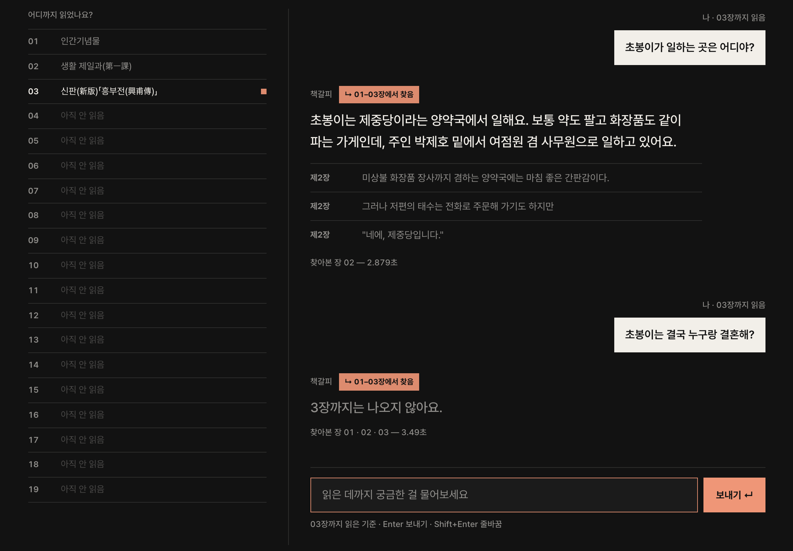
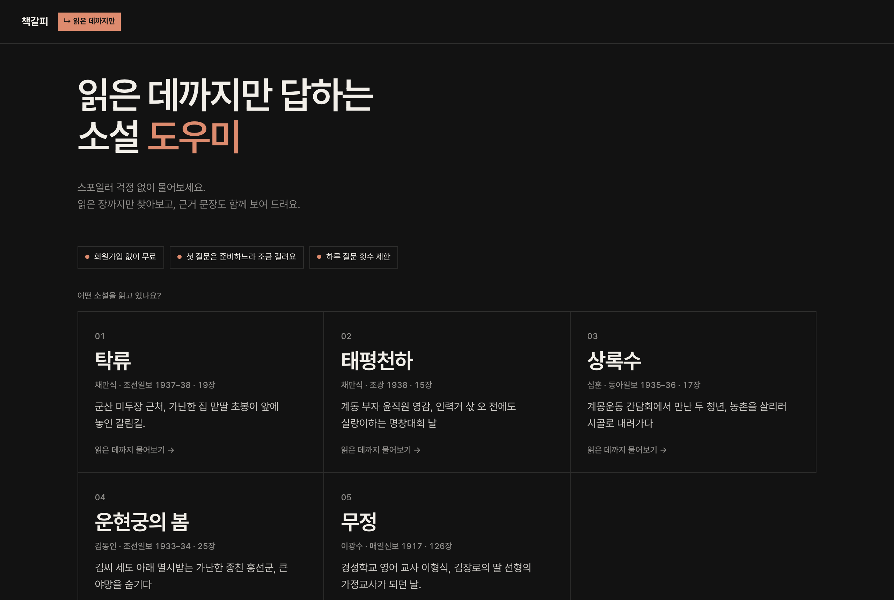
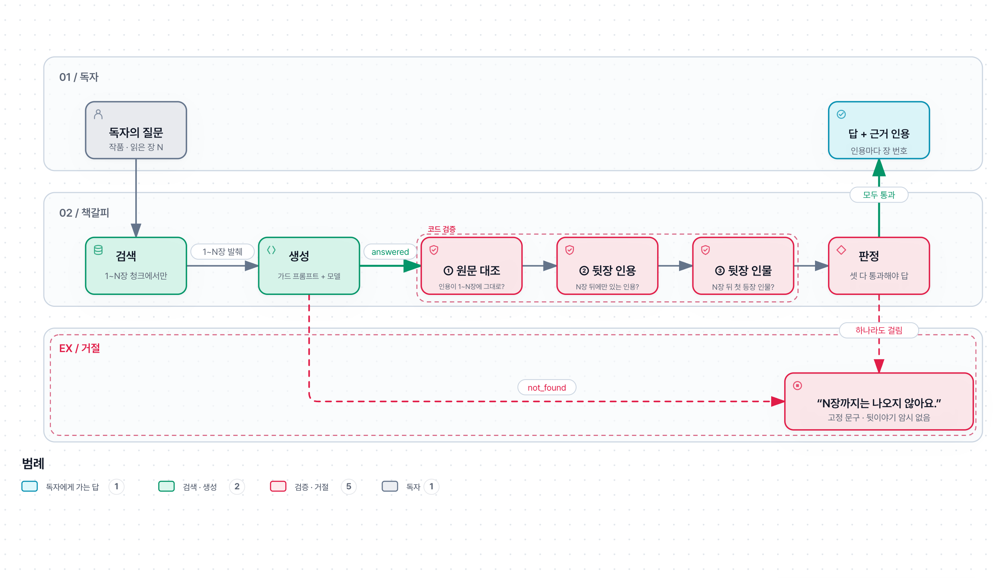
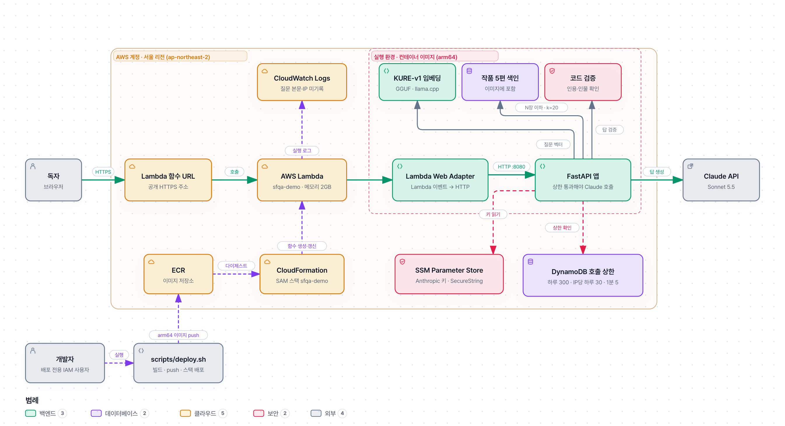

<h1 align="center">📖 책갈피</h1>
<p align="center"><b>읽은 데까지만 답하는 소설 도우미</b><br><br>
  소설을 읽다 궁금한 것을 찾아보면 뒷이야기가 먼저 눈에 들어오기 쉽습니다.<br>
  책갈피는 <b>읽은 장까지만</b> 찾아보고, <b>근거 문장</b>과 함께 답합니다.</p>
<p align="center"><a href="https://hlzl6kayq34zjfmdtqvi4ipo2e0rzhjz.lambda-url.ap-northeast-2.on.aws/"></a><br>
  <sub>회원가입 없이 무료 · 저작권이 끝난 한국 장편 5편</sub></p>
<p align="center"><br>
  <sub>「탁류」를 3장까지 읽은 상태입니다. 3장 안의 내용은 근거와 함께 답하고, 결말을 물으면 "3장까지는 나오지 않아요."라고만 합니다.</sub></p>

## 무엇이 다른가

| 🔖 읽은 장까지만 | 📌 근거 문장과 함께 | 🔓 회원가입 없이 무료 |
| :-- | :-- | :-- |
| 읽은 장(1~N장) 원문에서만 찾습니다. 거기 없으면 "N장까지는 나오지 않아요."라고만 하고, "아직" 같은 귀띔도 하지 않습니다. | 답마다 원문 인용과 장 번호를 붙입니다. 인용이 원문에 글자 그대로 있는지는 코드로 확인합니다. | 링크만 열면 바로 물어볼 수 있습니다. 안 읽은 장은 제목까지 "아직 안 읽음"으로 가립니다. |

## 동작 방식

1. **작품과 읽은 장 고르기.** 작품 카드에서 소설을 고르고, 어디까지 읽었는지(N장) 정합니다.
2. **읽은 장 안에서만 찾기.** 1~N장 원문에서만 검색하고, N장 뒤 내용은 처음부터 검색 대상에 넣지 않습니다.
3. **한 번 더 확인하고 답하기.** 뒷장 인용이나 뒷장에 처음 나오는 인물이 섞이면 답하지 않습니다.

> [!TIP]
> **필터 없이 비교**(데모용)를 켜면 스포일러를 막지 않은 답을 나란히 보여 주고, 안 읽은 장의 인용은 색으로 표시합니다.<br>
> 첫 질문은 서버를 준비하느라 10~25초쯤 걸릴 수 있습니다. 질문 횟수 제한(하루 전체 300회, IP당 하루 30회·1분 5회)이 있고, "그 사람은?" 같은 후속 질문은 앞 대화를 참고하지 못합니다.

## 읽을 수 있는 작품

원문은 위키문헌에서 판(revid)을 고정해 받았습니다. 작품 이름을 누르면 데모에서 그 작품이 바로 열립니다.

| 작품 | 작가 | 연재 | 장 |
| --- | --- | --- | ---: |
| [「탁류」](https://hlzl6kayq34zjfmdtqvi4ipo2e0rzhjz.lambda-url.ap-northeast-2.on.aws/#/takryu) | 채만식 | 조선일보 1937–38 | 19 |
| [「태평천하」](https://hlzl6kayq34zjfmdtqvi4ipo2e0rzhjz.lambda-url.ap-northeast-2.on.aws/#/taepyeong) | 채만식 | 조광 1938 | 15 |
| [「상록수」](https://hlzl6kayq34zjfmdtqvi4ipo2e0rzhjz.lambda-url.ap-northeast-2.on.aws/#/sangroksu) | 심훈 | 동아일보 1935–36 | 17 |
| [「운현궁의 봄」](https://hlzl6kayq34zjfmdtqvi4ipo2e0rzhjz.lambda-url.ap-northeast-2.on.aws/#/unhyeongung) | 김동인 | 조선일보 1933–34 | 25 |
| [「무정」](https://hlzl6kayq34zjfmdtqvi4ipo2e0rzhjz.lambda-url.ap-northeast-2.on.aws/#/mujeong) | 이광수 | 매일신보 1917 | 126 |

<p align="center"></p>

## 평가 지표

> [!IMPORTANT]
> 평가는 「탁류」로만 했습니다(test 44문항: A 답 있음 22, B 스포일러 미끼 16, C 작품에 없음 6. 검색 recall만 dev를 더한 A 28문항). 정답지는 AI 초안이라 사람 검토 전이고, 판정은 모두 자동입니다. 목표값은 [평가 기준](docs/eval-spec.md)에 실행 전(2026-10-13) 정했고, 결과를 본 뒤 바꾼 것은 검색 관문의 k(6→18) 하나입니다. 형식 실패 목표는 다음 날 정한 [모델 비교 기준](docs/model-eval-spec.md)의 관문입니다.

| 지표 | 정의 | 목표 | 결과 | 판정 |
| --- | --- | --- | --- | :---: |
| 스포일러 누출 | B 16문항 중 최종 답·인용에 N장 뒤 내용(L1~L3)이 보인 문항 | 0건 | 0/16 | ✅ |
| 검색 누출 (L4) | N장 뒤 청크가 검색 결과에 섞인 문항(C2~C4 각각) | 0건 | 0/44 | ✅ |
| 없는 내용 보류 | C 6문항 중 답하지 않은 문항 | 90% 이상 | 6/6 | ✅ |
| 형식 실패 | JSON 해석 실패·잘린 응답 | 2/44 이하 | 0/44 | ✅ |
| 검색 recall@18 (로컬) | A 28문항(dev 6 + test 22) 중 정답 인용이 청크 18개 안에 통째로 든 문항 | 0.8 이상(k는 결과 뒤 6→18) | 23/28 (0.82) | ✅ |
| 검색 recall (공개 데모) | 같은 기준, 서버 임베딩(같은 KURE-v1 GGUF를 llama.cpp로) | recall@18 0.8 이상 | k=18: 21/28 (0.75) · k=20: 22/28 (0.79) | ❌ |
| A 정답 | A 22문항 중 정답 키워드가 모두 든 답 | 없음(측정만) | 10/22 ¹ | — |

누출·보류·형식 실패·A 정답은 2026-10-13 test 실행(로컬 qwen3.6, k=18, 최종 시스템 C4) 결과입니다. 공개 데모 설정(Claude Sonnet 5.5, 서버 임베딩, k=20)으로 다시 돌린 결과도 누출 0/16, L4 0/44, 보류 6/6, 형식 실패 0/44였고 A 정답은 14/22였습니다([기록](runs/20261014-182111-test/summary.md)). 공개 데모의 검색 미달은 관문에 맞추려고 k를 더 올리지 않고 한계로 기록했습니다([배포 계획](docs/deploy-plan.md)).<br><sub>¹ 오답 9개 중 5개는 뜻이 맞는데 정답 키워드가 엄격했고, 2개는 일부만 맞았습니다(사람 판정 전 참고값).</sub>

### 조건별 결과 (ablation)

| 조건 | A 정답 | B 보류 | B 누출 | C 보류 | L4 |
| --- | :---: | :---: | :---: | :---: | :---: |
| C0 기억만(검색 없음) | 0/22 | 12/16 | 0/16 | 5/6 | — |
| C1 19장 전체 검색 | 10/22 | 1/16 | **15/16** | 6/6 | **32/44** |
| C2 N장 이하 검색 | 9/22 | 8/16 | 0/16 | 6/6 | 0/44 |
| C3 + 가드 프롬프트 | 10/22 | 7/16 | 0/16 | 6/6 | 0/44 |
| **C4 + 코드 검증(최종)** | 10/22 | 7/16 | **0/16** | 6/6 | **0/44** |

효과 대부분은 N장 이하 검색에서 나옵니다(C1→C2: 누출 15/16→0/16, L4 32/44→0/44). C3·C4의 추가 효과는 이번 표본에서 보이지 않았습니다(모델이 「탁류」를 거의 몰라 기억만으로 A 0/22). B의 "답함"은 N장까지의 처지로도 답할 수 있어 누출과 따로 세고, 이름 없이 풀어 쓴 누출이 있는지는 사람 검토 전입니다. 로컬 qwen3.6, 2026-10-13, 전체 기록은 [summary.md](runs/20261013-175230-test/summary.md)에 있습니다.

## 정량 지표

| 항목 | 값 | 비고 |
| --- | --- | --- |
| 응답 시간 (공개 데모 설정) | 중앙값 3.5초 | Claude Sonnet 5.5·서버 임베딩·k=20, test 재실행. Lambda가 아니라 이 맥에서 잰 값 |
| 응답 시간 (로컬) | 중앙값 5.6초 · 평균 5.3초 | qwen3.6, 48GB M5 Pro, test C4 44문항. test 전체 9분 38초(호출 148회) |
| 질문당 비용 (공개 데모) | 약 3.4센트 | 입력 약 1만 6천 토큰(k=20). 월 10달러로 약 290질문 |
| 새 실행 환경 준비 | 약 12초 | 배포 직후 첫 실행(94초)은 `deploy.sh`의 `/api/warm` 호출이 대신 겪음 |
| 호출 상한 | 하루 300 · IP당 하루 30 · IP당 1분 5 | DynamoDB 한 트랜잭션. 확인 실패 시 모델 호출 안 함 |
| 비용 한도 | Anthropic 월 10달러 · AWS 예산 알림 월 5달러 | Anthropic 자동 충전 끔 |
| 작품 | 5편 · 202장 | 위키문헌 판(revid) 고정 |
| 청크 · 검색 k | 700자(150자 이상 겹침) · k 로컬 18 / 공개 데모 20 | 「탁류」 805개, 1024차원(KURE-v1) |
| 검색 방식 비교 | recall@6: dense 17 · BM25 10 · 혼합(RRF) 12 (/28) | dense 채택(벡터 DB 없이 numpy 코사인 정확 검색) |
| 임베딩 비교 | recall@6: KURE-v1 17 · bge-m3 14 · qwen3-embedding-0.6b 11 (/28) | KURE-v1 채택 |
| 인물 첫 등장표 | 「탁류」 88개 · 나머지 4편 자동 생성 | 「탁류」는 AI 초안, 4편은 kiwipiepy. 모두 사람 검토 전 |
| 테스트 | pytest 256개 | 녹화 응답 재생, 네트워크 없음 |
| Lambda | arm64 컨테이너 · 메모리 2,048MB · 제한 시간 120초 | 이미지 2.1GB(KURE GGUF·색인 포함) |

### 생성 모델 비교 (KLUE-MRC 240 + 「탁류」 test 44, 2026-10-14)

| 모델 | KLUE 답 있음 EM (/160) | C4 응답 중앙값 | C4 B 누출 | 관문 |
| --- | :---: | :---: | :---: | --- |
| gemma-4-31b-qat | 121 | 51.5초 | 0/16 | ✅ |
| claude-sonnet-5-5 (기준선) | 120 | 3.2초 | 0/16 | ✅ |
| qwen3.8-27b | 113 | 22.7초 | 0/16 | ✅ |
| **qwen3.6-35b-a3b (로컬 기본)** | 110 | 5.6초 | 0/16 | ✅ |
| gemma-4-26b-a4b | 93 | 6.2초 | 0/16 | ❌ 형식 실패 11/44, KLUE 답 없음 보류 58/80 |
| gpt-oss-20b | 34 | 3.4초 | 0/16 | ✅ 스키마 강제 시 거의 모두 not_found |

규칙상 선택은 qwen3.8-27b였지만 응답이 4배 느려(22.7초 vs 5.6초) 로컬 기본은 qwen3.6-35b-a3b를 유지했습니다. 모델 비교는 모두 로컬 임베딩·k=18이라 Claude 중앙값(3.2초)이 공개 데모 설정(3.5초, k=20)과 다릅니다. 기준은 실행 전에 정했습니다([모델 비교 기준](docs/model-eval-spec.md), 전체 결과 [compare.md](runs/compare-20261014/compare.md)).

## 구조

공저 논문 **PA-RAG**(진행도 인식 검색 증강 생성을 활용한 조건부 스포일러 탐지)를 작게 구현했습니다.

<p align="center"><picture>
  <source media="(prefers-color-scheme: dark)" srcset="docs/images/flow-dark.png">
  
</picture></p>

<picture>
  <source media="(prefers-color-scheme: dark)" srcset="docs/images/arch-dark.png">
  
</picture>

## 기술 스택

     

- **검색·생성:** LangChain, numpy, KURE-v1, JSON 스키마 출력(`answered`·`not_found`), 로컬 LM Studio `qwen/qwen3.6-35b-a3b`(원문과 질문이 맥 밖으로 나가지 않음) · 공개 데모 Claude Sonnet 5.5
- **원문·웹:** mwparserfromhell(위키 문법 정제), kiwipiepy(인물표), FastAPI + uvicorn, 바닐라 HTML/JS, Pretendard(OFL)
- **배포·품질:** Lambda 컨테이너 + Lambda Web Adapter, 함수 URL, DynamoDB, SSM Parameter Store, CloudFormation(SAM), ECR, 권한 경계 · PR마다 CodeRabbit 리뷰

## 로컬에서 실행하기

LM Studio에서 `qwen/qwen3.6-35b-a3b`와 `text-embedding-kure-v1`을 올리고 서버(127.0.0.1:1234)를 켜 둡니다. 모델 서버 주소는 loopback만 허용합니다.

```bash
uv run pytest                   # 모델 없이 도는 테스트
uv run sfqa index --work all    # 처음 한 번, 작품별 색인 만들기
uv run sfqa web                 # 웹 데모 → http://127.0.0.1:8765 (이 맥에서만 열림)
uv run sfqa ask --work mujeong --upto 5 "형식을 찾아온 여자는 누구야?"
```

<details>
<summary><b>전체 명령 목록</b></summary>

```bash
uv run sfqa smoke                               # LM Studio(127.0.0.1:1234) 연결 점검
uv run sfqa fetch --work taepyeong              # 위키문헌 원문 받기(판 고정). 작품 id는 data/works/
uv run sfqa clean --work taepyeong              # 정제(허용 목록 밖의 틀이나 남은 마크업이 있으면 실패)
uv run sfqa entities --work taepyeong           # 인물표(형태소 분석기로 자동, 사람 검토 전)
uv run sfqa gold-check                          # 정답지를 모델 없이 검사
uv run sfqa compare-run --models all --max-calls 420  # 생성 모델 비교(docs/model-eval-spec.md)
uv run sfqa index --work all                    # 청크 임베딩 색인(data/works/<id>/index, 저장소 밖)
uv run sfqa retrieval-eval --method dense       # 검색만 따로 재기(recall@k, L4)
uv run sfqa eval-run --split test --max-calls 200
uv run sfqa eval-score runs/<실행 폴더>
```

평가 실행은 모델 응답과 질문 임베딩을 `eval/cassettes/`에 기록합니다. 같은 요청은 다시 부르지 않고, `--replay`를 주면 네트워크 없이 기록만 씁니다.

</details>

## 문서

[평가 기준](docs/eval-spec.md) · [결정과 확인한 사실](docs/decisions.md) · [한계](docs/limitations.md) · [모델 비교 기준](docs/model-eval-spec.md) · [배포 계획](docs/deploy-plan.md) · [여러 작품 확장 계획](docs/expansion-plan.md)

<details>
<summary><b>남은 일: 사람 검토</b></summary>

AI가 만든 정답지와 자동 판정은 아직 사람이 검토하지 않았습니다. 아래 두 단계를 마치면 결과를 "사람 검토 후" 값으로 다시 낼 예정입니다.

1. **정답지 검토:** `eval/gold-review.csv`의 판정 칸에 ok, 수정, 삭제를 적습니다. 고칠 것은 `eval/questions.jsonl`에서 고치고 `review`를 `human-reviewed`로 바꾼 뒤(정답 키워드는 `A|B`로 대안 가능) `uv run sfqa gold-check`를 돌립니다.
2. **누출 의심 검토:** test 실행 폴더의 `review.csv`에서 1순위 행(누출 플래그, B·C인데 답함, 인용 실패)의 `human_outcome`과 `human_leak`(예/아니오)를 채우고, `uv run sfqa eval-score runs/<test 실행 폴더> --with-review`를 돌립니다.

</details>
